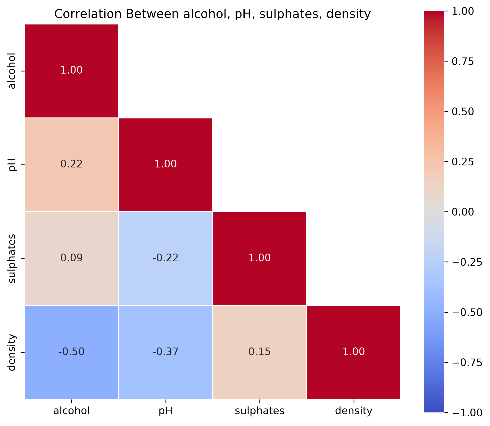
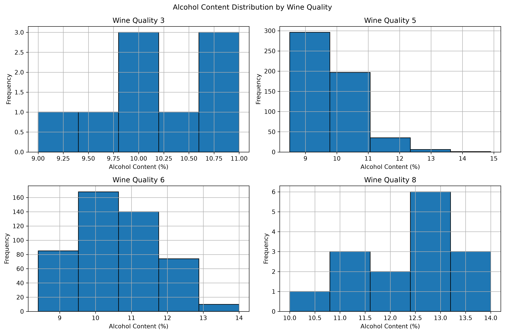
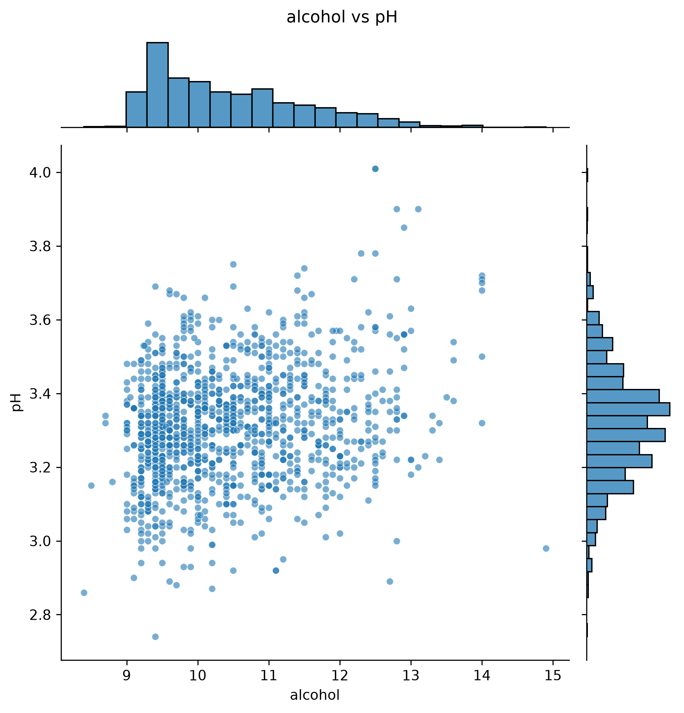
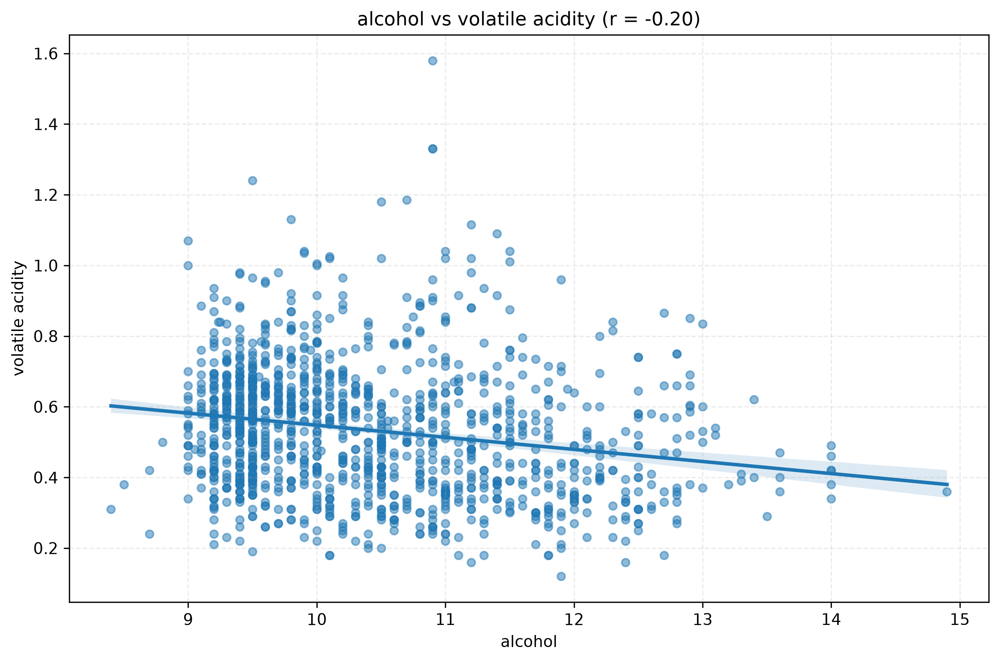
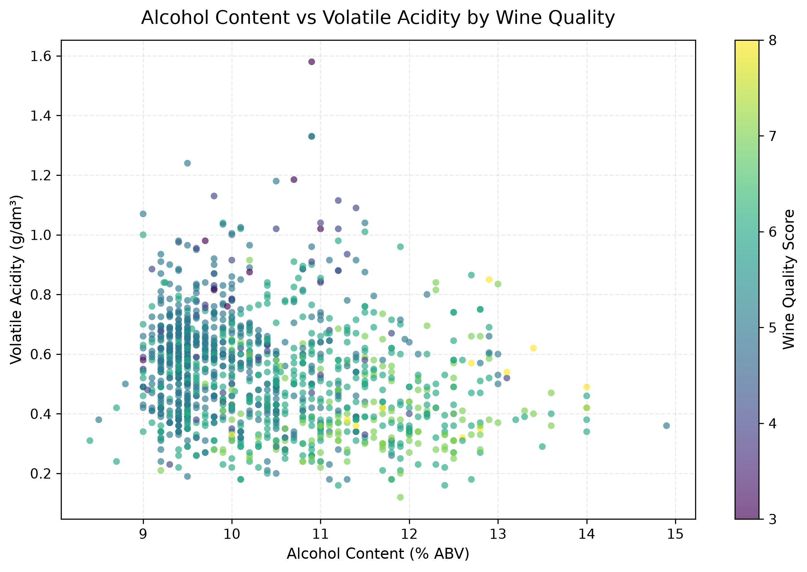
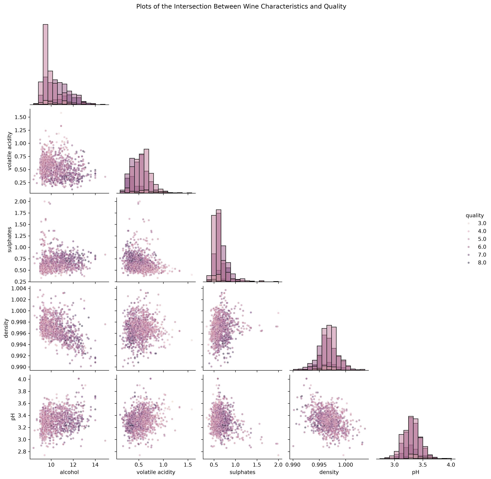

# Exploratory Data Analyzer

> A simple project using the Python Standard Library, NumPy, Matplotlib Pyplot, Pandas and Seaborn to analyze numerical datasets quickly and easily.
> If you have a CSV file with lots of numerical data, use this Python script to clean up data, understand the numbers, and visualise information and correlations.

## Start

**1. Install the required libraries**

```bash
pip install pandas numpy matplotlib seaborn
```

**2. Run it on your data:**

```bash
python3 data_explore.py -p mydata.csv -c alcohol pH -pt histogram -v
```

**3. Look at the matplotlib window with the plot.**

Want it saved as an image instead? Add `-e` to export to image. You can even add an optional `-o` namespace to name the file:

```bash
python3 data_explore.py -p mydata.csv -c alcohol pH -pt histogram -e -o my_first_plot
```

That writes `my_first_plot_histogram.png` into the folder you ran the command from.

---

## Information and program pipeline

```
  CSV -> Data Cleaning -> Analyse (optional) -> Plot -> Export (optional)
```

1. **Load**: reads your CSV into a pandas DataFrame..
2. **Clean**:
   - Duplicate rows are thrown out.
   - Every column is converted to numbers. Anything that isn't a number becomes a NaN.
   - Any row with a NaN gets removed.
3. **Check your columns**: the script makes sure every column you named actually exists. If you typo one, it shows you the real column names so you can fix it.
4. **Analyse** *(only with `-na`)*: prints the mean, median and standard deviation of each column you picked.
5. **Plot** *(only with `-pt`)*: draws the chart you asked for.
6. **Export** *(only with `-e`)*: saves it as a high-resolution PNG (300 dpi, so it looks sharp in a report or on a slide).

---

## Command Line Arguments

| Flag | Long version | What it does | Default |
|---|---|---|---|
| `-p` | `--path` | Which CSV file to load | `example_data.csv` |
| `-c` | `--columns` | Which columns to work on (list as many as you like, separated by spaces) | *none, and the script stops here* |
| `-pt` | `--plottype` | Which chart to draw (see the gallery below) | *none (no chart)* |
| `--hue` | | A column used to colour or group the chart | *none* |
| `-na` | `--numerical-analysis` | Print mean / median / std for your columns | off |
| `-v` | `--verbose` | Print a running commentary **and pop up the plot window** | off |
| `-e` | `--export` | Save the plot as a PNG | off |
| `-o` | `--output` | The start of the saved file's name | `data_explore_export` |

To get started, you can use the following flags:

- **To *see* a plot, use `-v`.**
- **To *keep* a plot, use `-e`.**

You can use both together.

**Column names with spaces** need quotes: `-c alcohol "volatile acidity" pH`

**Output names** are built as `<output>_<plottype>.png`. So `-o wine -pt kde -e` gives you `wine_kde.png`.

---

## Plots

There are 11 plots to evaluate the data and assess traits and correlations. Below are some plots you might consider for certain scenarios:

| Plot (`-pt`) | What it shows | Min columns |
|---|---|---|
| `histogram` | Bars counting how many rows fall into each range. The classic first look. | 1 |
| `kde` | A smooth curve version of the histogram. Easier to compare groups because curves don't hide each other like bars do. | 1 |
| `ecdf` | A rising line showing "what fraction of rows are at or below this value?" Great for comparing groups with no bin-size fiddling. | 1 |
| `boxplot` | A box for the middle 50% of values, a line for the median, and dots for outliers. Quick way to spot weird values. | 1 |
| `violinplot` | Like a boxplot, but you can see the whole shape of the data too. Looks like a violin, hence the name. | 1 |
| `scatterplot` | One dot per row, first column on the x-axis, second on the y-axis. If you give a `--hue`, dots are coloured by it and you get a colour bar. | 2 |
| `regression` | A scatterplot plus a best-fit line, with the correlation number (`r`) in the title. Handy for "does more X mean more Y?" | 2 |
| `jointplot` | A scatterplot with little histograms down the sides, so you see the relationship *and* each variable's shape. | 2 |
| `pairplot` | A grid where every column is plotted against every other. A quick way to spot interesting pairs to investigate. | 2 |
| `heatmap` | A coloured grid of correlations between your columns. Red = move together, blue = move opposite, white = no link. Ignores `--hue`. | 2 |
| `barplot` | The mean of each column. With a `--hue`, one bar per group (with a little error bar showing uncertainty). | 1 |

> **Which two columns does a 2-variable plot use?**
> The **first two** you list after `-c`. Order matters! `-c alcohol pH` puts alcohol on the x-axis and pH on the y-axis. `-c pH alcohol` swaps them. Extra columns beyond the first two are ignored by `scatterplot`, `regression` and `jointplot`, but used by `pairplot` and `heatmap`.

---

## Hue

Adding a `--hue` command line argument is to colour plot points based on the data of a specific column.

For example, if a dataset has a `quality` column scored 3 to 8:

```bash
python3 data_explore.py -p wine.csv -c alcohol -pt kde --hue quality -v
```

Instead of one curve, you get one curve **per quality score**, so you can see whether better wines tend to have more alcohol. The hue column doesn't have to be one of your `-c` columns as long as it exists in the dataset.

---

## Reading the numerical analysis

Add the `-na` flag to see the mean, median, and standard deviation of the dataset. Example:

```
          alcohol        pH  volatile acidity
Mean    10.015263  3.186725          0.500510
Median  10.048364  3.170991          0.498186
Std      0.961179  0.153793          0.099965
```

---

## Examples





